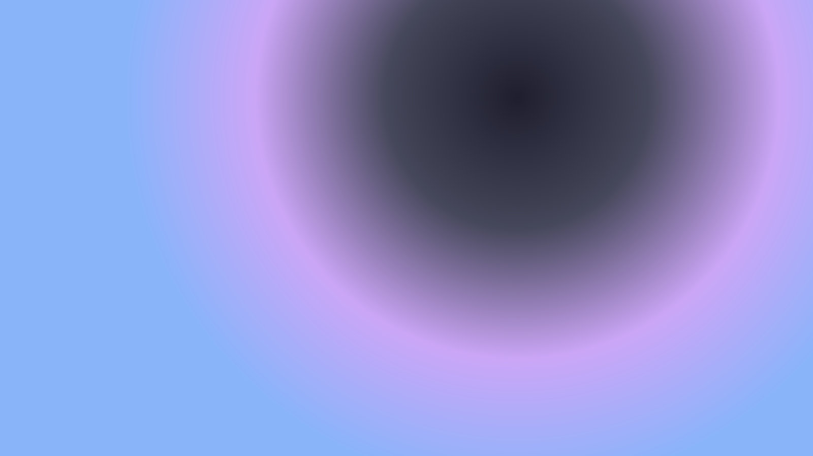
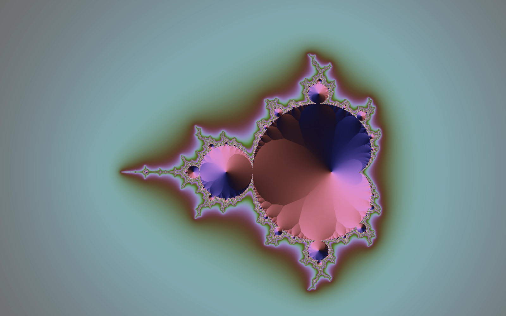

Большую часть дня я провожу в Neovim. Тема Catppuccin Mocha, AstroNvim поверх, терминал на весь экран. Когда я сел переделывать блог, стало ясно, что хочу читать свои тексты в той же среде, в которой их пишу. Только без необходимости открывать терминал.

Сразу оговорюсь: это не про «хакерскую эстетику». Никакого зелёного на чёрном, никаких ASCII-рамок и мерцания. Современный редактор выглядит спокойно: пастельные цвета, мягкий контраст, много воздуха.

## Слои вместо линий

Первое, что бросается в глаза в Catppuccin, — панели почти не разделены рамками. Сайдбар чуть темнее основного буфера, фон окна ещё темнее. Глаз считывает структуру по перепаду яркости.



В CSS это превращается в четыре уровня:

```css
:root {
  --bg-page: var(--ctp-crust);    /* фон страницы */
  --bg-sidebar: var(--ctp-mantle); /* дерево файлов */
  --bg-buffer: var(--ctp-base);    /* основной буфер */
  --bg-cursorline: var(--ctp-surface0);
}
```

Сами цвета не вписаны руками: они берутся из пакета `@catppuccin/palette` и раскладываются в переменные при сборке. Если когда-нибудь дойдут руки до светлой Latte, поменяется только источник значений.

## Один цвет — одна роль

Пастельных акцентов в палитре много, и соблазн раскрасить всё велик. Я ограничил себя четырьмя ролями:

- **mauve** — ссылки;
- **blue** — активный файл в дереве;
- **subtext0** — даты и метаданные;
- **green** — теги.

Всё остальное — `text` и оттенки серого. Особенно важно, что тело статьи всегда основного цвета: пастель на тёмном фоне красива в интерфейсе, но в длинном абзаце контраст проваливается и читать становится тяжело.

## Шрифты

Моноширинный шрифт живёт только в «хроме»: дерево, табы, строка статуса, номера строк и заголовки. Сам текст набран Inter, 17 пикселей, с интерлиньяжем около 1,7 и колонкой примерно в 70 знаков. Редактор — это всё-таки метафора, а читать длинный текст моноширинным шрифтом утомительно.



## Детали, которые продают иллюзию

Несколько мелочей делают страницу похожей на буфер, при этом не мешая ей оставаться обычной веб-страницей:

1. Номера строк в гаттере. Абзац считается одной строкой, как в vim с включённым `wrap`.
2. Подсветка строки под курсором мыши, тем же `surface0`, что и в дереве.
3. Мигающий блочный курсор в конце заголовка.
4. Строка статуса, в которой процент считается от настоящей прокрутки.

<figure>
  <video src="./loop.mp4" autoplay loop muted playsinline width="960" height="540"></video>
  <figcaption>loop.mp4 — зацикленное видео вместо гифки: весит в разы меньше и не мылит цвета.</figcaption>
</figure>

Чего здесь сознательно нет: командной строки, в которую нельзя ничего ввести, и перехвата клавиш. Нарисованный интерфейс, который не работает, раздражает сильнее, чем его отсутствие.

## Что дальше

Пока это прототип. Следующий шаг — светлая тема и, возможно, пара осмысленных сочетаний клавиш. Но только таких, которые не ломают привычное поведение браузера.
