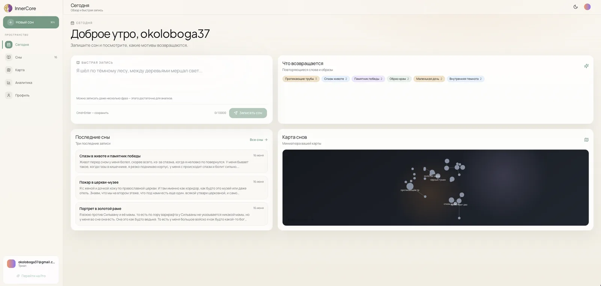
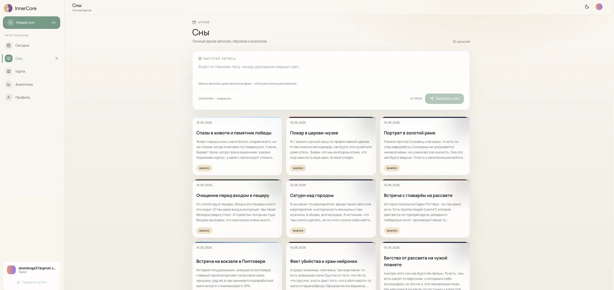
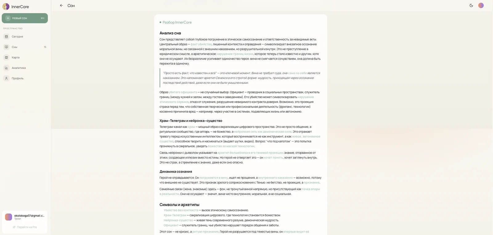
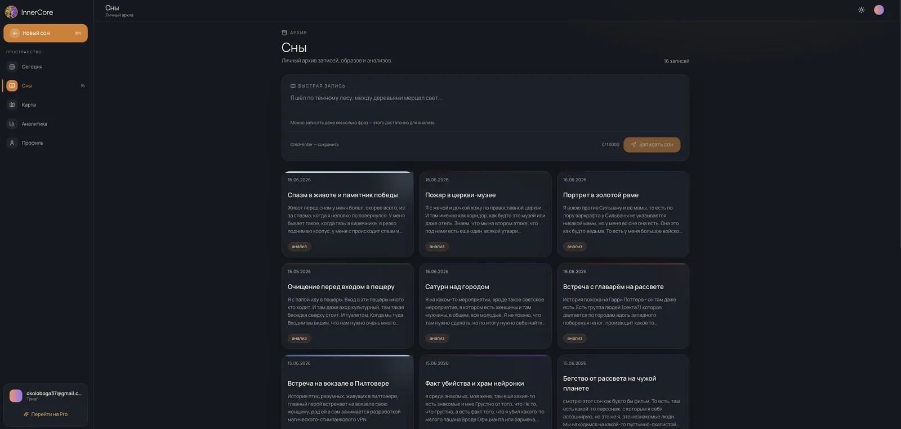
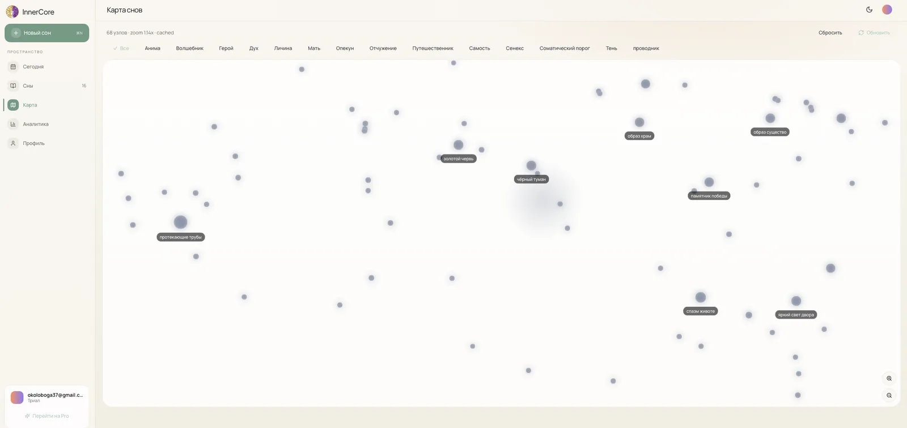
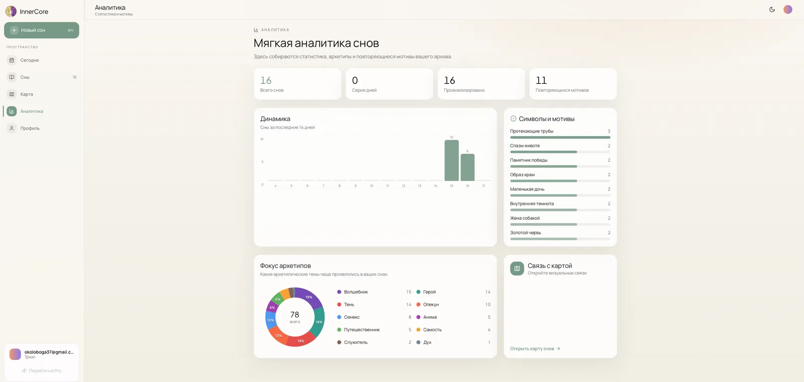
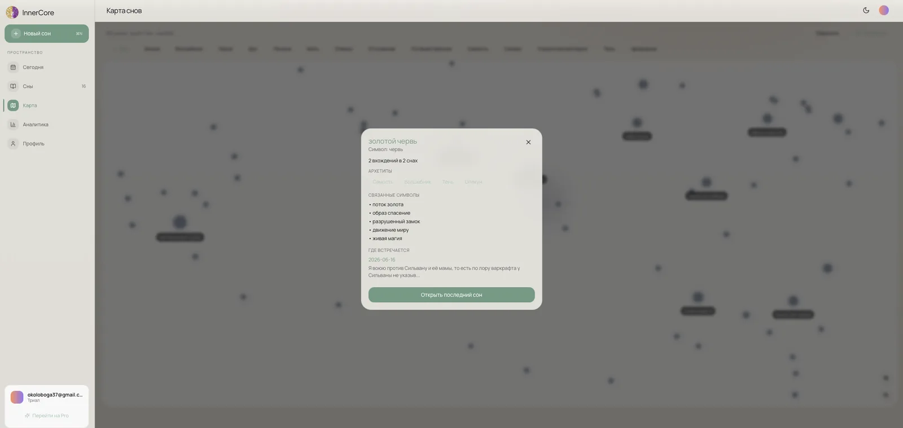
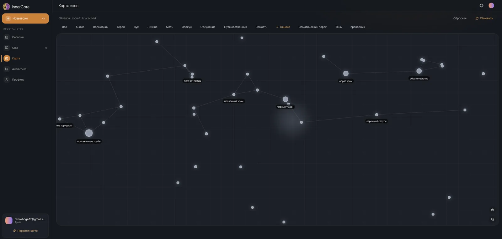
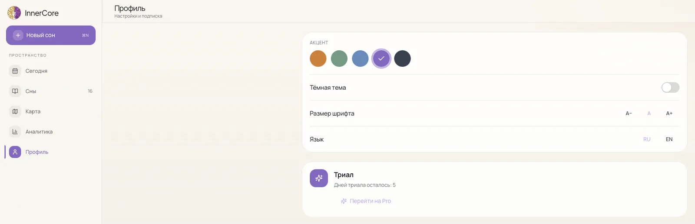

Сон забывается за минуты, а вместе с ним уходит и то, что он говорил о человеке. InnerCore сохраняет сон и сразу объясняет его: архетипы, символы, повторяющиеся мотивы.

<figure class="shot">
  <button type="button" popovertarget="shot-01" aria-label="Открыть снимок в полном размере">
    
  </button>
  

    <button class="shot-back" type="button" popovertarget="shot-01" popovertargetaction="hide" aria-label="Закрыть снимок"></button>
    <button class="shot-zoom" type="button" popovertarget="shot-01" popovertargetaction="hide" aria-label="Закрыть снимок">
      
    </button>
  

</figure>

Записал сон — он сразу в дневнике, разбор приходит следом. Ждать с пустым экраном не нужно, поэтому привычка записывать не умирает на второй день.

<figure class="shot">
  <button type="button" popovertarget="shot-02" aria-label="Открыть снимок в полном размере">
    
  </button>
  

    <button class="shot-back" type="button" popovertarget="shot-02" popovertargetaction="hide" aria-label="Закрыть снимок"></button>
    <button class="shot-zoom" type="button" popovertarget="shot-02" popovertargetaction="hide" aria-label="Закрыть снимок">
      
    </button>
  

</figure>

Разбор не пересказ, а рамка: какие архетипы в сне, что повторяется от ночи к ночи, на что обратить внимание. Читать его интереснее, чем собственный текст, — иначе дневник забрасывают.

<figure class="shot">
  <button type="button" popovertarget="shot-03" aria-label="Открыть снимок в полном размере">
    
  </button>
  

    <button class="shot-back" type="button" popovertarget="shot-03" popovertargetaction="hide" aria-label="Закрыть снимок"></button>
    <button class="shot-zoom" type="button" popovertarget="shot-03" popovertargetaction="hide" aria-label="Закрыть снимок">
      
    </button>
  

</figure>

По конкретному сну можно поговорить: спросить, что значит сцена, почему она вернулась, что с этим делать. Ответ опирается на сон, а не на общие слова про сновидения.

<figure class="shot">
  <button type="button" popovertarget="shot-04" aria-label="Открыть снимок в полном размере">
    
  </button>
  

    <button class="shot-back" type="button" popovertarget="shot-04" popovertargetaction="hide" aria-label="Закрыть снимок"></button>
    <button class="shot-zoom" type="button" popovertarget="shot-04" popovertargetaction="hide" aria-label="Закрыть снимок">
      
    </button>
  

</figure>

Карта собирает символы в узлы и группирует их по архетипам. Через месяц видно не отдельные сны, а сюжеты, которые возвращаются.

<figure class="shot">
  <button type="button" popovertarget="shot-05" aria-label="Открыть снимок в полном размере">
    
  </button>
  

    <button class="shot-back" type="button" popovertarget="shot-05" popovertargetaction="hide" aria-label="Закрыть снимок"></button>
    <button class="shot-zoom" type="button" popovertarget="shot-05" popovertargetaction="hide" aria-label="Закрыть снимок">
      
    </button>
  

</figure>

Сон можно надиктовать голосом. Утром это быстрее, чем печатать, и именно поэтому запись вообще происходит.

<figure class="shot">
  <button type="button" popovertarget="shot-06" aria-label="Открыть снимок в полном размере">
    
  </button>
  

    <button class="shot-back" type="button" popovertarget="shot-06" popovertargetaction="hide" aria-label="Закрыть снимок"></button>
    <button class="shot-zoom" type="button" popovertarget="shot-06" popovertargetaction="hide" aria-label="Закрыть снимок">
      
    </button>
  

</figure>

Сны лежат плотной сеткой — по ним быстро пробежать глазами. Прогресс разбора видно сразу: что уже разобрано, что ещё в работе.

<figure class="shot">
  <button type="button" popovertarget="shot-07" aria-label="Открыть снимок в полном размере">
    
  </button>
  

    <button class="shot-back" type="button" popovertarget="shot-07" popovertargetaction="hide" aria-label="Закрыть снимок"></button>
    <button class="shot-zoom" type="button" popovertarget="shot-07" popovertargetaction="hide" aria-label="Закрыть снимок">
      
    </button>
  

</figure>

Первый вход ведёт по шагам, а не бросает в пустой дневник: пустой продукт выглядит сломанным, даже если работает.

<figure class="shot">
  <button type="button" popovertarget="shot-08" aria-label="Открыть снимок в полном размере">
    
  </button>
  

    <button class="shot-back" type="button" popovertarget="shot-08" popovertargetaction="hide" aria-label="Закрыть снимок"></button>
    <button class="shot-zoom" type="button" popovertarget="shot-08" popovertargetaction="hide" aria-label="Закрыть снимок">
      
    </button>
  

</figure>

Разбор идёт в фоне и догоняет запись. Дневник остаётся отзывчивым, даже когда модель думает.

<figure class="shot">
  <button type="button" popovertarget="shot-09" aria-label="Открыть снимок в полном размере">
    
  </button>
  

    <button class="shot-back" type="button" popovertarget="shot-09" popovertargetaction="hide" aria-label="Закрыть снимок"></button>
    <button class="shot-zoom" type="button" popovertarget="shot-09" popovertargetaction="hide" aria-label="Закрыть снимок">
      
    </button>
  

</figure>

Здесь снимки веб-версии. Мобильная — отдельной карточкой: [InnerCore для iOS и Android](/portfolio/mobile-apps/innercore/).
