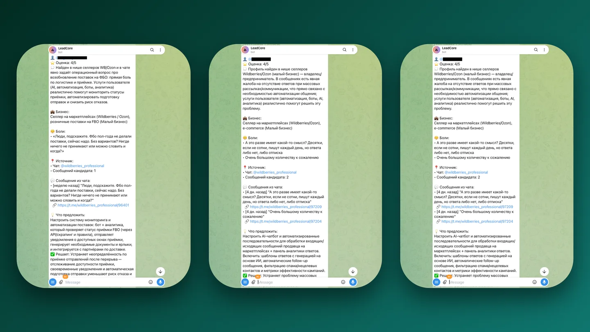
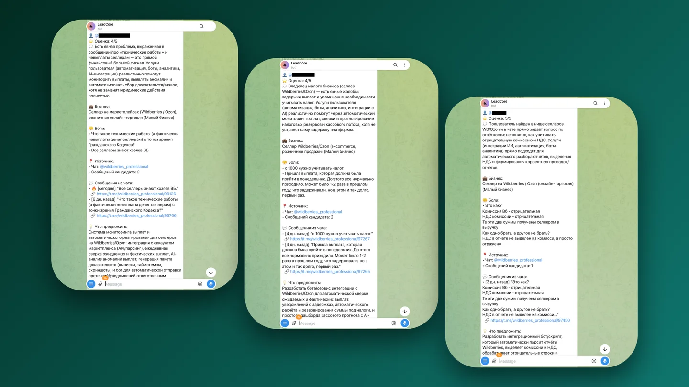
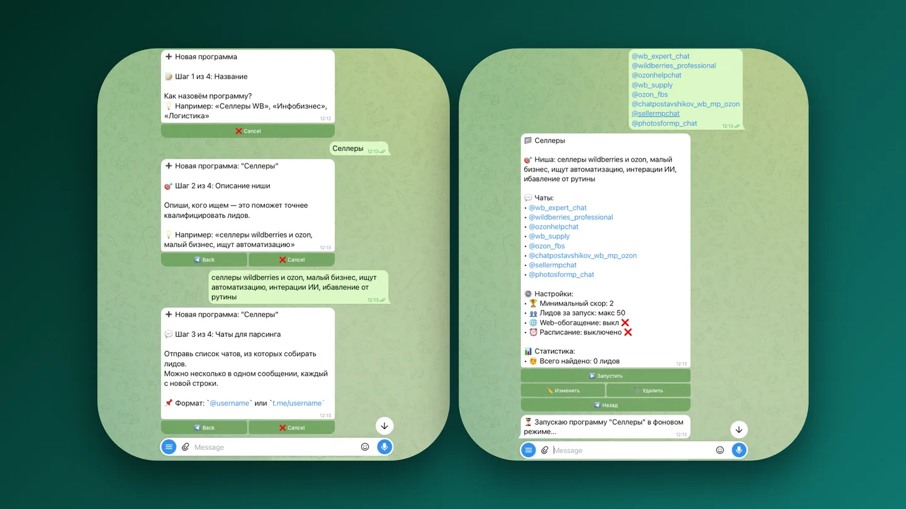

Заказы приходят в чаты, а не на почту. Кто читает чаты руками — теряет часы; кто не читает — теряет заказы.

<figure class="shot">
  <button type="button" popovertarget="shot-01" aria-label="Открыть снимок в полном размере">
    
  </button>
  

    <button type="button" popovertarget="shot-01" popovertargetaction="hide" aria-label="Закрыть снимок">
      
    </button>
  

</figure>

Бот просматривает всю новую ленту и оставляет только сообщения, где действительно есть задача и бюджет. Дорогая проверка достаётся единицам сообщений, а не всему потоку, поэтому подписка стоит дешевле, чем час внимания.

<figure class="shot">
  <button type="button" popovertarget="shot-02" aria-label="Открыть снимок в полном размере">
    
  </button>
  

    <button type="button" popovertarget="shot-02" popovertargetaction="hide" aria-label="Закрыть снимок">
      
    </button>
  

</figure>

Найденное не теряется: база показывает, кому что нужно, где болит и какие темы повторяются. Через неделю видно, за что на рынке платят, а за что нет, — без чтения сотен чатов.

<figure class="shot">
  <button type="button" popovertarget="shot-03" aria-label="Открыть снимок в полном размере">
    
  </button>
  

    <button type="button" popovertarget="shot-03" popovertargetaction="hide" aria-label="Закрыть снимок">
      
    </button>
  

</figure>

По найденным болям бот собирает черновики постов: не «полезные советы», а ответ на то, что люди уже спрашивают. Тарифы, лимиты и админка сделаны так, чтобы продукт работал без ежедневного участия.
