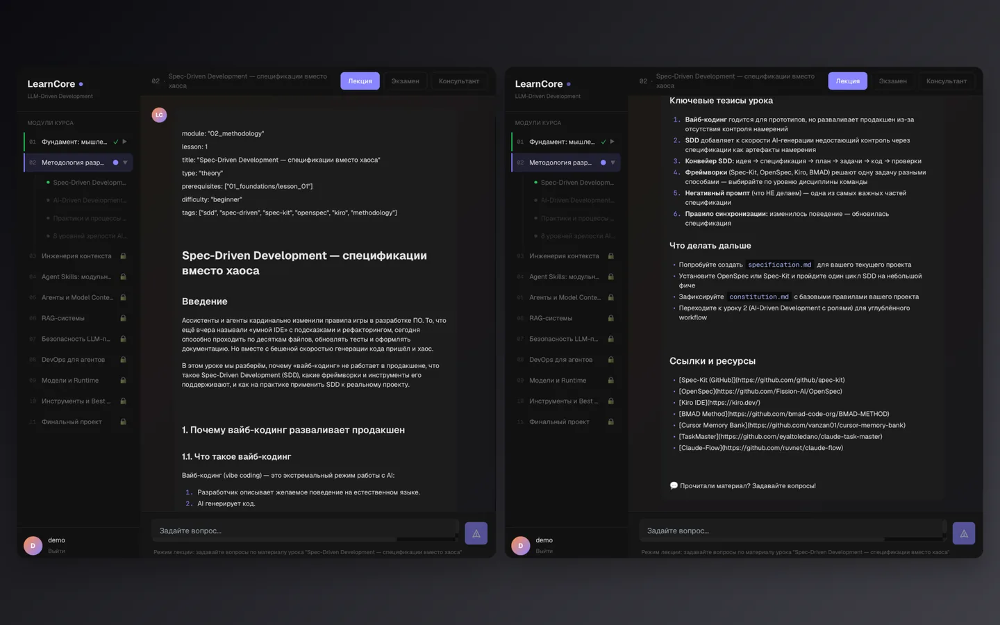
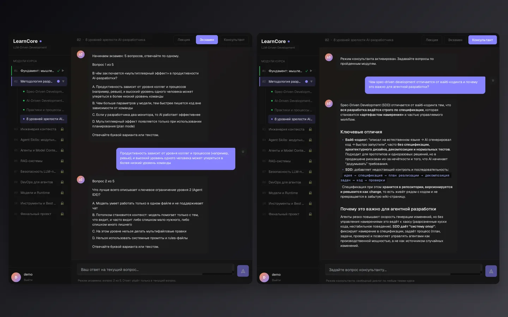
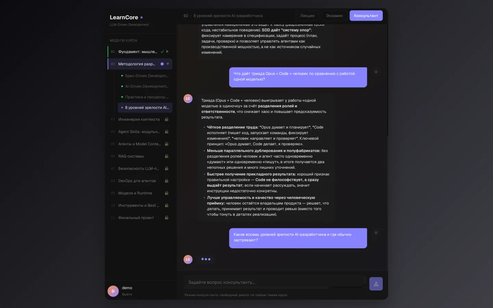

Курс, который проходят с моделью рядом: не «прочитал статью», а видно, где остановился, что понял и что спросить.

Материал разбит на шаги, прогресс сохраняется. Человек возвращается и продолжает с того же места — а не начинает заново и не бросает на третьем уроке.

Модель отвечает по материалу курса, а не по интернету вообще. Подключить другую модель можно без переделки платформы — это запас на будущее, когда сегодняшняя подорожает или уйдёт.

Ответ приходит по мере готовности и не обрывается на плохой сети: человек видит, как появляется текст, вместо пустого экрана и таймера.
