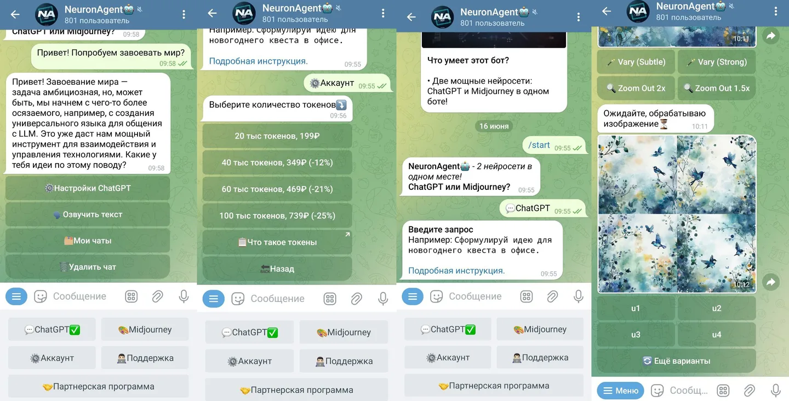
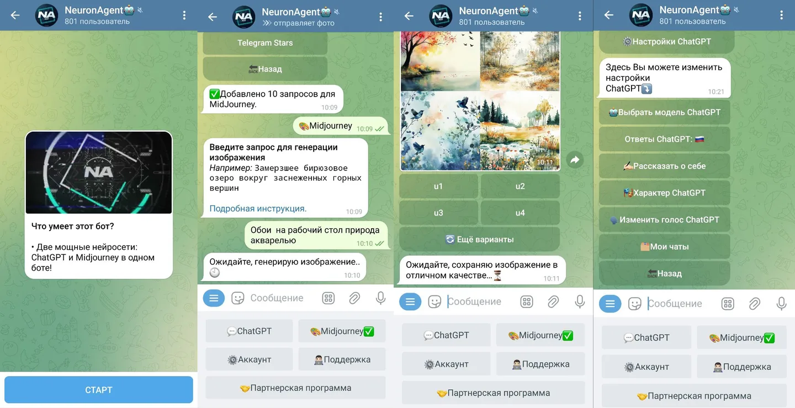

Клиент хотел продавать подписку на нейросеть в Телеграме, без своего приложения и без разработчика в штате. Сделал полный цикл — от бота до платежей.

<figure class="shot">
  <button type="button" popovertarget="shot-01" aria-label="Открыть снимок в полном размере">
    
  </button>
  

    <button type="button" popovertarget="shot-01" popovertargetaction="hide" aria-label="Закрыть снимок">
      
    </button>
  

</figure>

Пользователь отправляет голосовое, бот отвечает текстом. Второй режим — картинка по описанию. Ничего не нужно устанавливать: мессенджер уже у всех.

<figure class="shot">
  <button type="button" popovertarget="shot-02" aria-label="Открыть снимок в полном размере">
    
  </button>
  

    <button type="button" popovertarget="shot-02" popovertargetaction="hide" aria-label="Закрыть снимок">
      
    </button>
  

</figure>

Вокруг продукта — подписки, рефералка и админка с аналитикой. Лимиты считаются до запроса, а не после: каждый ответ модели стоит денег, и считать это «потом» — значит платить из своего кармана.
