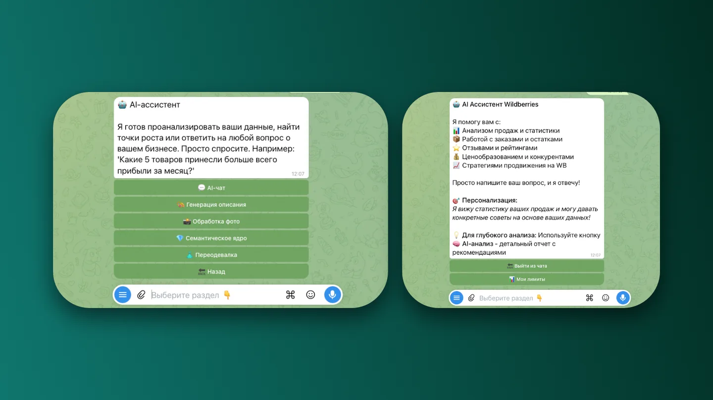
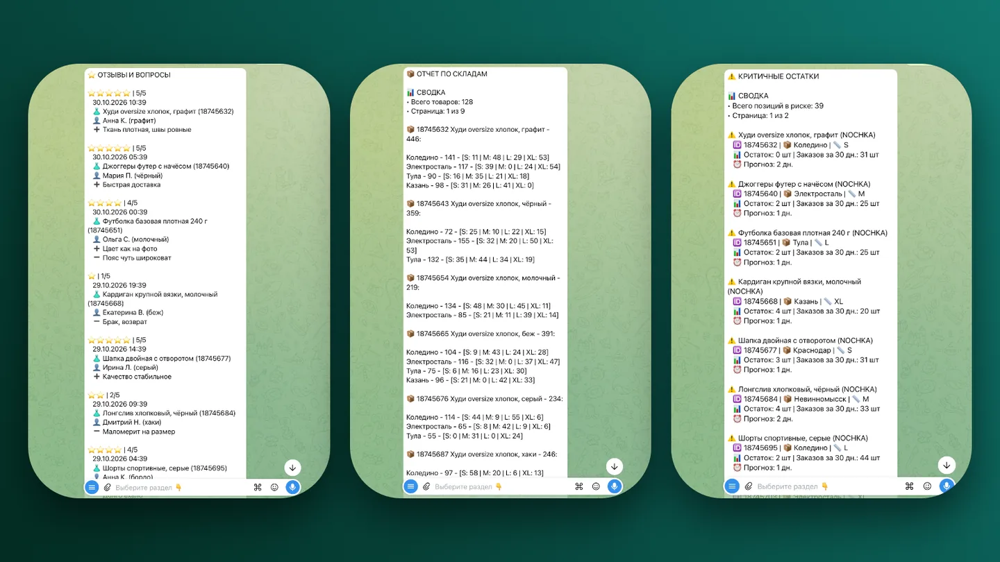
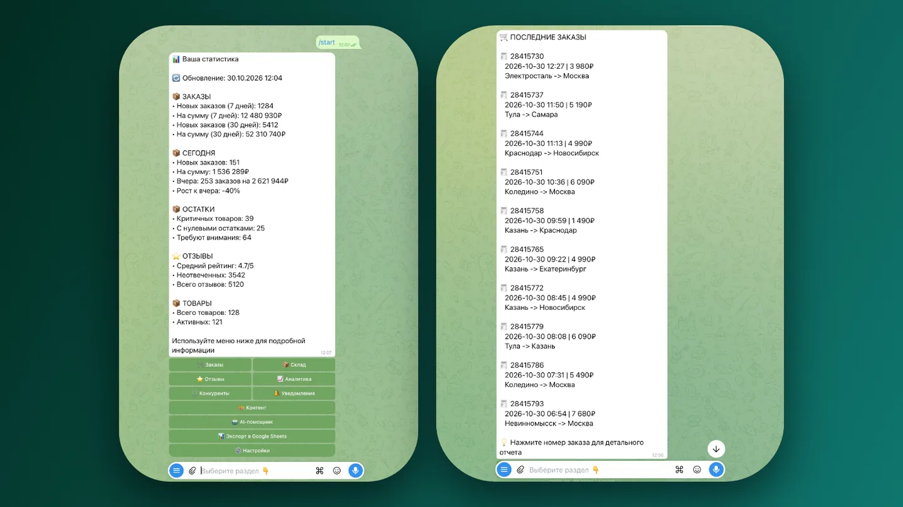
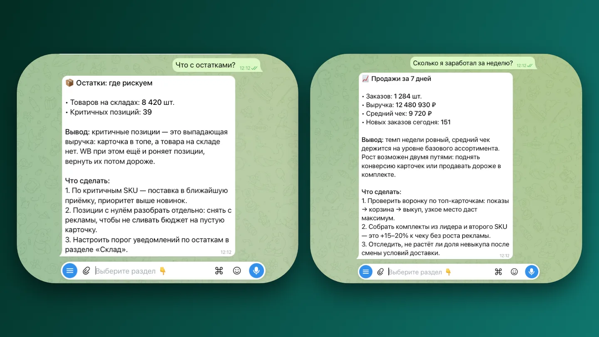

Продавец на маркетплейсе тонет в рутине: сотни отзывов, пять выгрузок по статистике, склады и уведомления в разных окнах.

Отзывы влияют на продажи, но отвечать на них вручную некогда. Модель отвечает с учётом тона карточки и истории оценок — не шаблоном, но и не чем попало в публичном ответе.

Вопрос можно задать словами: «почему просели продажи в марте». Система находит нужные срезы и отвечает по данным, а не общими соображениями о сезонности.

Цифры собраны в одном месте: вместо пяти выгрузок и таблиц — один экран, по которому видно, что происходит с продажами.

О проблеме продавец узнаёт раньше, чем увидит её в отчёте за неделю: уведомления приходят сами.

Склады и остатки — там же, где отзывы и статистика. Чем меньше окон, тем меньше шансов, что что-то забудут.
