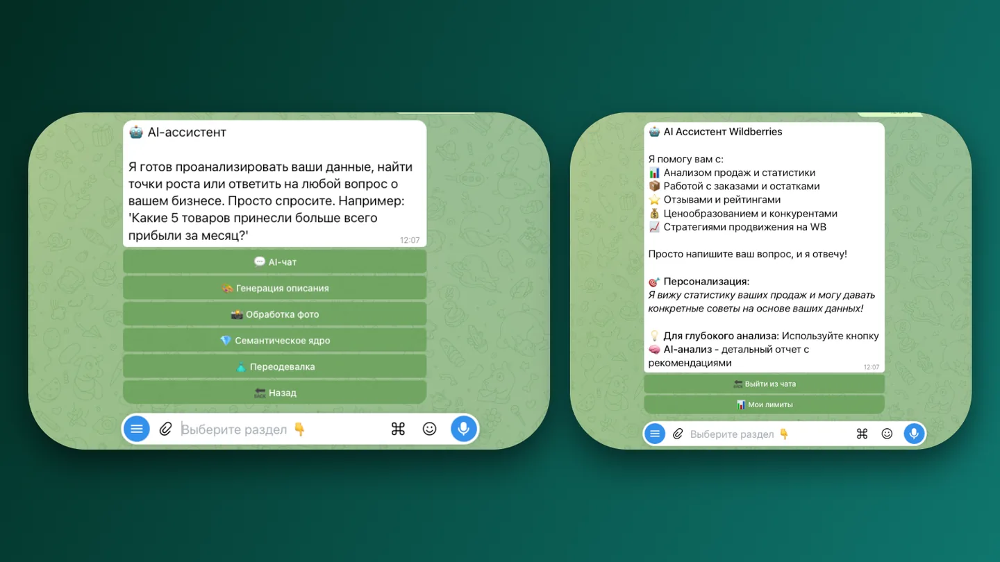
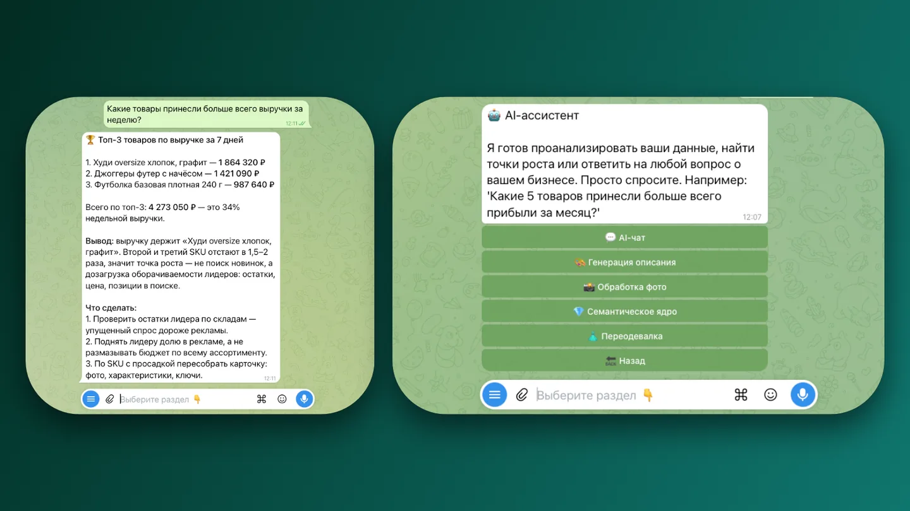

Продавец на маркетплейсе тонет в рутине: сотни отзывов, пять выгрузок по статистике, склады и уведомления в разных окнах.

<figure class="shot">
  <button type="button" popovertarget="shot-01" aria-label="Открыть снимок в полном размере">
    
  </button>
  

    <button type="button" popovertarget="shot-01" popovertargetaction="hide" aria-label="Закрыть снимок">
      
    </button>
  

</figure>

Отзывы влияют на продажи, но отвечать на них вручную некогда. Модель отвечает с учётом тона карточки и истории оценок — не шаблоном, но и не чем попало в публичном ответе.

<figure class="shot">
  <button type="button" popovertarget="shot-02" aria-label="Открыть снимок в полном размере">
    
  </button>
  

    <button type="button" popovertarget="shot-02" popovertargetaction="hide" aria-label="Закрыть снимок">
      
    </button>
  

</figure>

Вопрос можно задать словами: «почему просели продажи в марте». Система находит нужные срезы и отвечает по данным, а не общими соображениями о сезонности.

<figure class="shot">
  <button type="button" popovertarget="shot-03" aria-label="Открыть снимок в полном размере">
    
  </button>
  

    <button type="button" popovertarget="shot-03" popovertargetaction="hide" aria-label="Закрыть снимок">
      
    </button>
  

</figure>

Цифры собраны в одном месте: вместо пяти выгрузок и таблиц — один экран, по которому видно, что происходит с продажами.

<figure class="shot">
  <button type="button" popovertarget="shot-04" aria-label="Открыть снимок в полном размере">
    
  </button>
  

    <button type="button" popovertarget="shot-04" popovertargetaction="hide" aria-label="Закрыть снимок">
      
    </button>
  

</figure>

О проблеме продавец узнаёт раньше, чем увидит её в отчёте за неделю: уведомления приходят сами.

<figure class="shot">
  <button type="button" popovertarget="shot-05" aria-label="Открыть снимок в полном размере">
    
  </button>
  

    <button type="button" popovertarget="shot-05" popovertargetaction="hide" aria-label="Закрыть снимок">
      
    </button>
  

</figure>

Склады и остатки — там же, где отзывы и статистика. Чем меньше окон, тем меньше шансов, что что-то забудут.

<figure class="shot">
  <button type="button" popovertarget="shot-06" aria-label="Открыть снимок в полном размере">
    
  </button>
  

    <button type="button" popovertarget="shot-06" popovertargetaction="hide" aria-label="Закрыть снимок">
      
    </button>
  

</figure>

<figure class="shot">
  <button type="button" popovertarget="shot-07" aria-label="Открыть снимок в полном размере">
    
  </button>
  

    <button type="button" popovertarget="shot-07" popovertargetaction="hide" aria-label="Закрыть снимок">
      
    </button>
  

</figure>
