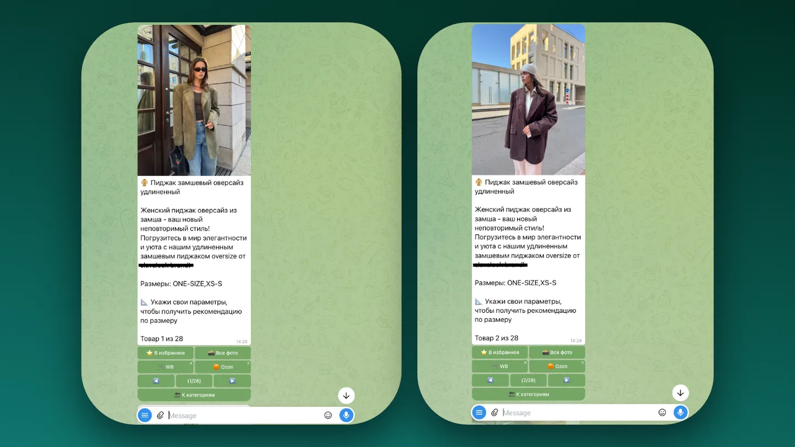

Для продавца одежды возврат «не подошло» — это двойная работа и испорченная карточка. Показать посадку заранее дешевле, чем принимать вещь назад.

<figure class="shot">
  <button type="button" popovertarget="shot-01" aria-label="Открыть снимок в полном размере">
    
  </button>
  

    <button class="shot-back" type="button" popovertarget="shot-01" popovertargetaction="hide" aria-label="Закрыть снимок"></button>
    <button class="shot-zoom" type="button" popovertarget="shot-01" popovertargetaction="hide" aria-label="Закрыть снимок">
      
    </button>
  

</figure>

Покупатель присылает своё фото и выбирает вещь из каталога продавца. Ничего не нужно мерить и никуда идти.

<figure class="shot">
  <button type="button" popovertarget="shot-02" aria-label="Открыть снимок в полном размере">
    
  </button>
  

    <button class="shot-back" type="button" popovertarget="shot-02" popovertargetaction="hide" aria-label="Закрыть снимок"></button>
    <button class="shot-zoom" type="button" popovertarget="shot-02" popovertargetaction="hide" aria-label="Закрыть снимок">
      
    </button>
  

</figure>

На выходе он же в этой вещи: лицо и поза сохраняются, меняется одежда. Так видно посадку и цвет, а не «примерно так».

<figure class="shot">
  <button type="button" popovertarget="shot-03" aria-label="Открыть снимок в полном размере">
    
  </button>
  

    <button class="shot-back" type="button" popovertarget="shot-03" popovertargetaction="hide" aria-label="Закрыть снимок"></button>
    <button class="shot-zoom" type="button" popovertarget="shot-03" popovertargetaction="hide" aria-label="Закрыть снимок">
      
    </button>
  

</figure>

Каталог продавец ведёт в обычной таблице: обновляет ассортимент сам, без разработчика и без выгрузки на сервер. Чем меньше посредников между товаром и покупателем, тем чаще каталог свежий.
