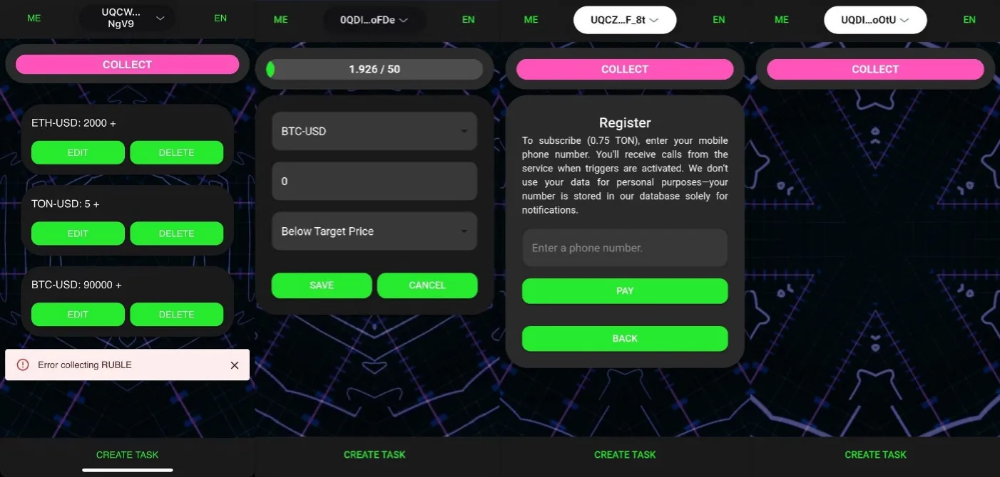

Цена ходит и ночью, а трейдер спит. Пользователь ставит уровень, сервис звонит, когда цена до него дошла.

<figure class="shot">
  <button type="button" popovertarget="shot-01" aria-label="Открыть снимок в полном размере">
    
  </button>
  

    <button type="button" popovertarget="shot-01" popovertargetaction="hide" aria-label="Закрыть снимок">
      
    </button>
  

</figure>

Звонок вместо пуша выбран намеренно: пуш можно не заметить в беззвучном режиме, звонок — нет. Внутри подписки с лимитом алертов, и одна цель даёт один звонок, сколько бы раз цена её ни пересекла.
