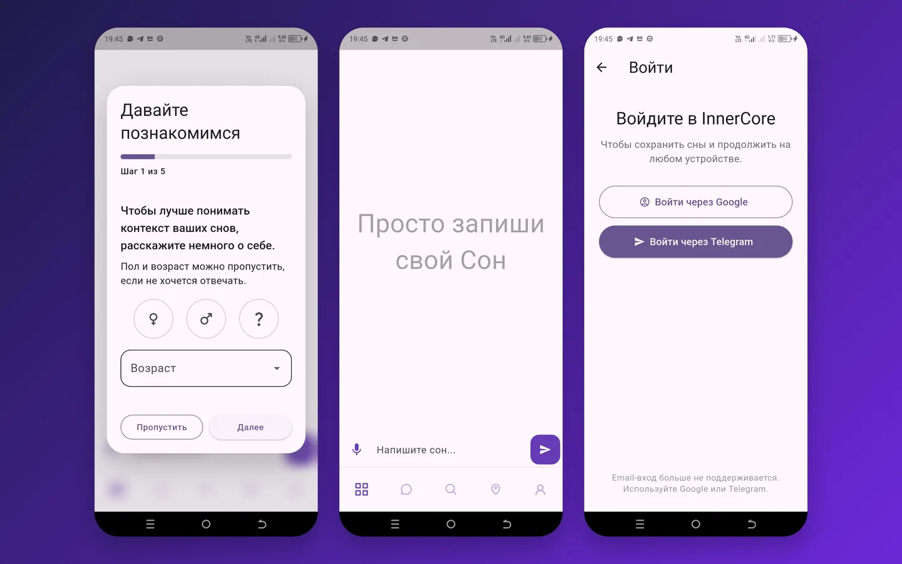
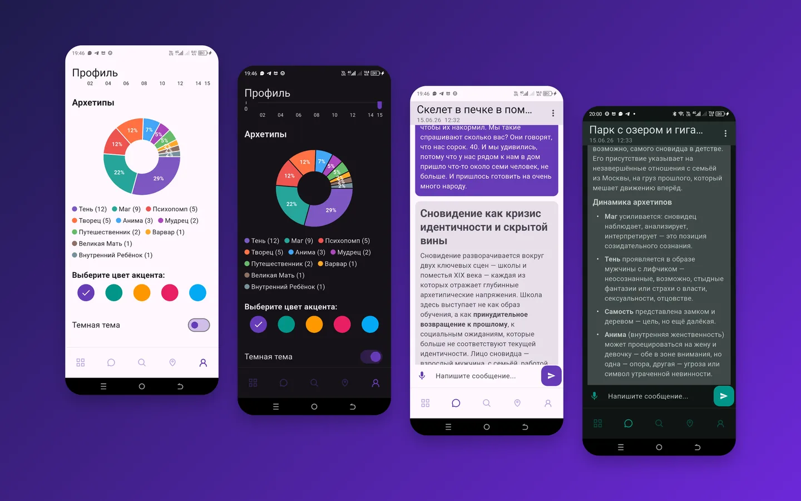
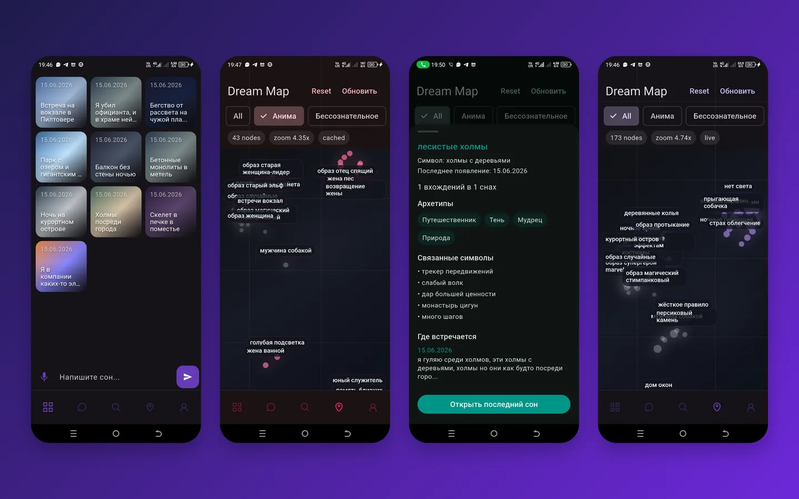

Сон забывается за минуты, а вместе с ним уходит и то, что он говорил о человеке. InnerCore сохраняет сон и сразу объясняет его: архетипы, символы, повторяющиеся мотивы.

<figure class="shot">
  <button type="button" popovertarget="shot-01" aria-label="Открыть снимок в полном размере">
    
  </button>
  

    <button type="button" popovertarget="shot-01" popovertargetaction="hide" aria-label="Закрыть снимок">
      
    </button>
  

</figure>

Записал сон — он сразу в дневнике, разбор приходит следом. Телефон под рукой утром, поэтому привычка записывать не умирает на второй день.

<figure class="shot">
  <button type="button" popovertarget="shot-02" aria-label="Открыть снимок в полном размере">
    
  </button>
  

    <button type="button" popovertarget="shot-02" popovertargetaction="hide" aria-label="Закрыть снимок">
      
    </button>
  

</figure>

Карта собирает символы в узлы и группирует их по архетипам. Через месяц видно не отдельные сны, а сюжеты, которые возвращаются.

<figure class="shot">
  <button type="button" popovertarget="shot-03" aria-label="Открыть снимок в полном размере">
    
  </button>
  

    <button type="button" popovertarget="shot-03" popovertargetaction="hide" aria-label="Закрыть снимок">
      
    </button>
  

</figure>

По конкретному сну можно поговорить: спросить, что значит сцена и почему она вернулась. Ответ опирается на сон, а не на общие слова про сновидения.

Здесь снимки приложения. Веб-версия — отдельной карточкой: [InnerCore в браузере](/portfolio/ai-automation/innercore/).
