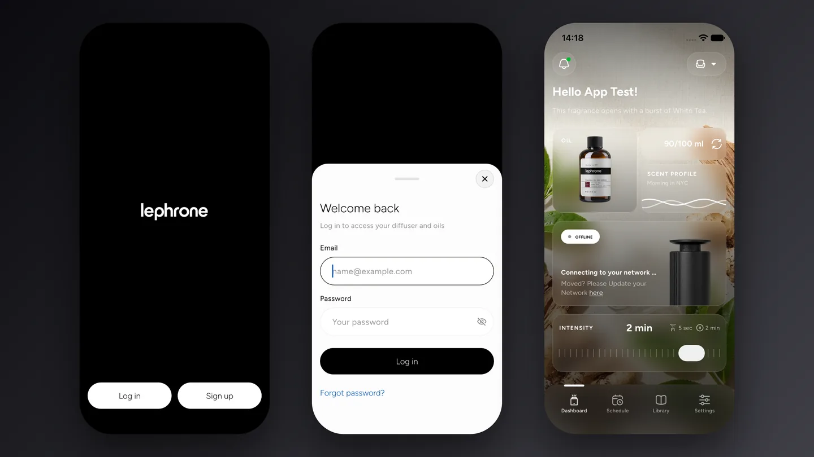
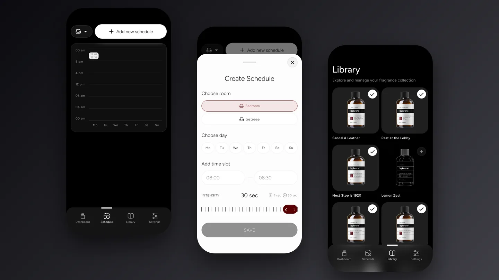
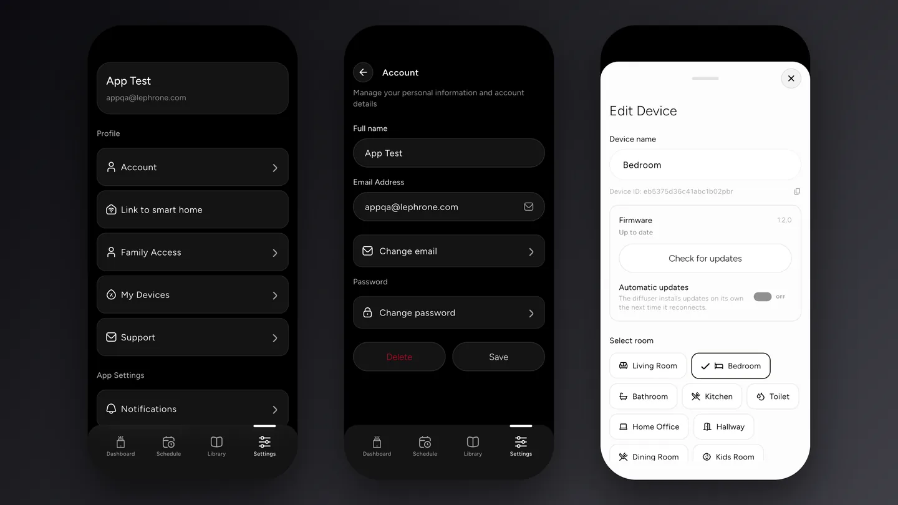
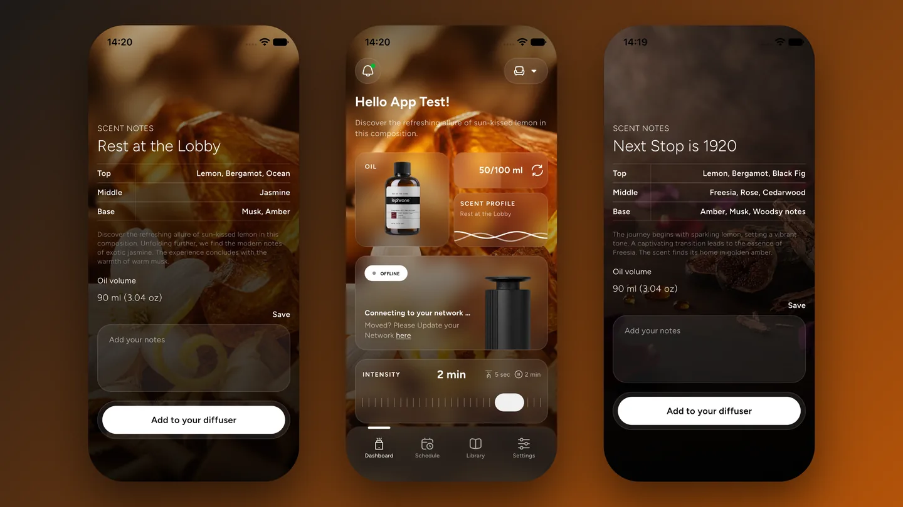

Аромадиффузор, который включается не кнопкой на корпусе, а расписанием в телефоне. Клиент из США, работа разбита на два этапа.

<figure class="shot">
  <button type="button" popovertarget="shot-01" aria-label="Открыть снимок в полном размере">
    
  </button>
  

    <button type="button" popovertarget="shot-01" popovertargetaction="hide" aria-label="Закрыть снимок">
      
    </button>
  

</figure>

Дни и часы задаются заранее: утром одно, вечером другое. Не нужно помнить про кнопку и не нужно возвращаться домой, чтобы включить.

<figure class="shot">
  <button type="button" popovertarget="shot-02" aria-label="Открыть снимок в полном размере">
    
  </button>
  

    <button type="button" popovertarget="shot-02" popovertargetaction="hide" aria-label="Закрыть снимок">
      
    </button>
  

</figure>

Интенсивность регулируется под комнату и настроение: в спальне тише, в гостиной заметнее.

<figure class="shot">
  <button type="button" popovertarget="shot-03" aria-label="Открыть снимок в полном размере">
    
  </button>
  

    <button type="button" popovertarget="shot-03" popovertargetaction="hide" aria-label="Закрыть снимок">
      
    </button>
  

</figure>

Сценарии собирают расписание и интенсивность в готовый режим — «работа», «вечер», «отпуск». Пользователю не приходится каждый раз настраивать заново.

<figure class="shot">
  <button type="button" popovertarget="shot-04" aria-label="Открыть снимок в полном размере">
    
  </button>
  

    <button type="button" popovertarget="shot-04" popovertargetaction="hide" aria-label="Закрыть снимок">
      
    </button>
  

</figure>

Прошивка сделана на модуле Tuya: устройство настраивается в привычном приложении и ведёт себя разумно при обрыве связи и после перезагрузки питания — не требует выдернуть розетку.
