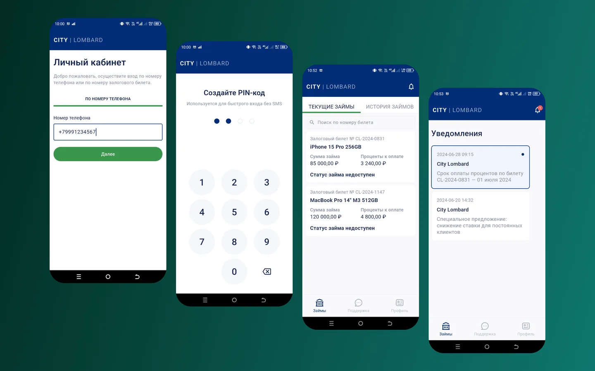
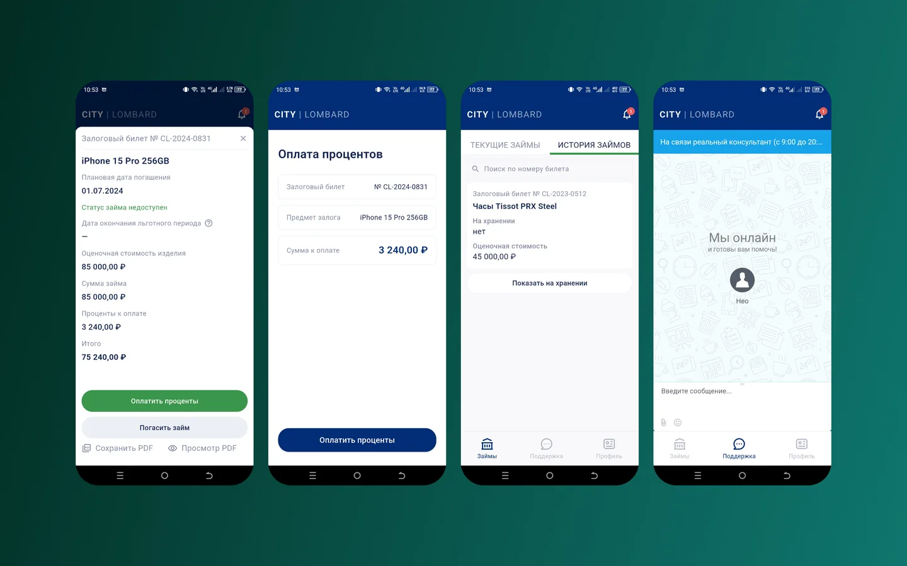
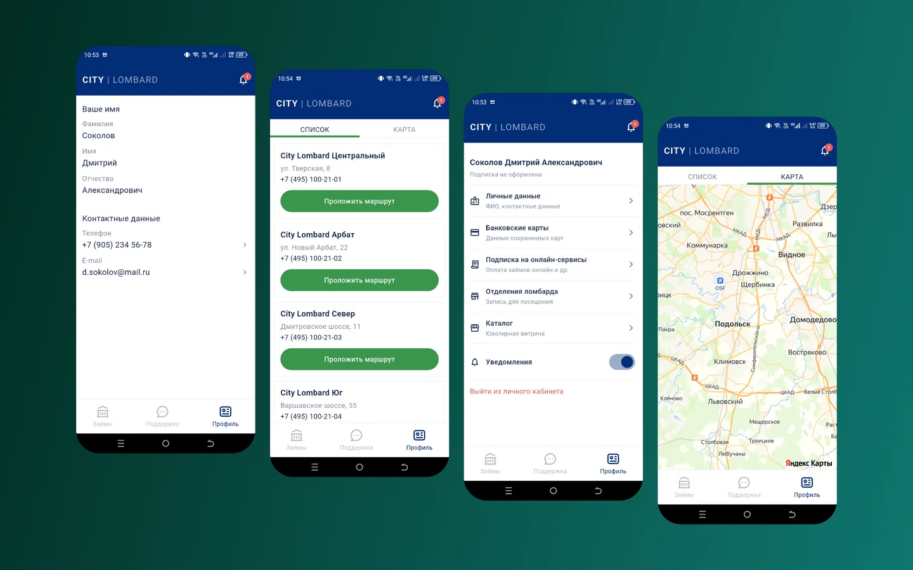

Клиенту ломбарда не нужно ехать в отделение, чтобы узнать оценку или дату выкупа. Данные при этом остаются в 1С, где их ведёт сам ломбард.

<figure class="shot">
  <button type="button" popovertarget="shot-01" aria-label="Открыть снимок в полном размере">
    
  </button>
  

    <button class="shot-back" type="button" popovertarget="shot-01" popovertargetaction="hide" aria-label="Закрыть снимок"></button>
    <button class="shot-zoom" type="button" popovertarget="shot-01" popovertargetaction="hide" aria-label="Закрыть снимок">
      
    </button>
  

</figure>

В приложении видно свои залоги, оценки и отделения. Человек не звонит и не приезжает ради цифры, которую и так носит в кармане.

<figure class="shot">
  <button type="button" popovertarget="shot-02" aria-label="Открыть снимок в полном размере">
    
  </button>
  

    <button class="shot-back" type="button" popovertarget="shot-02" popovertargetaction="hide" aria-label="Закрыть снимок"></button>
    <button class="shot-zoom" type="button" popovertarget="shot-02" popovertargetaction="hide" aria-label="Закрыть снимок">
      
    </button>
  

</figure>

Между приложением и 1С стоит прослойка: договорённости и учёт остаются там, где были, а клиент получает удобный экран. Двойного ввода нет — значит, нет и расхождений.

<figure class="shot">
  <button type="button" popovertarget="shot-03" aria-label="Открыть снимок в полном размере">
    
  </button>
  

    <button class="shot-back" type="button" popovertarget="shot-03" popovertargetaction="hide" aria-label="Закрыть снимок"></button>
    <button class="shot-zoom" type="button" popovertarget="shot-03" popovertargetaction="hide" aria-label="Закрыть снимок">
      
    </button>
  

</figure>

Проект жил в трёх расходящихся копиях. Свёл в одну ветку, собрал архив передачи и развернул на сервере заказчика. Остался внешний блокер: пока адрес сервера не разрешён в 1С, приложение доходит до экрана входа и останавливается.
