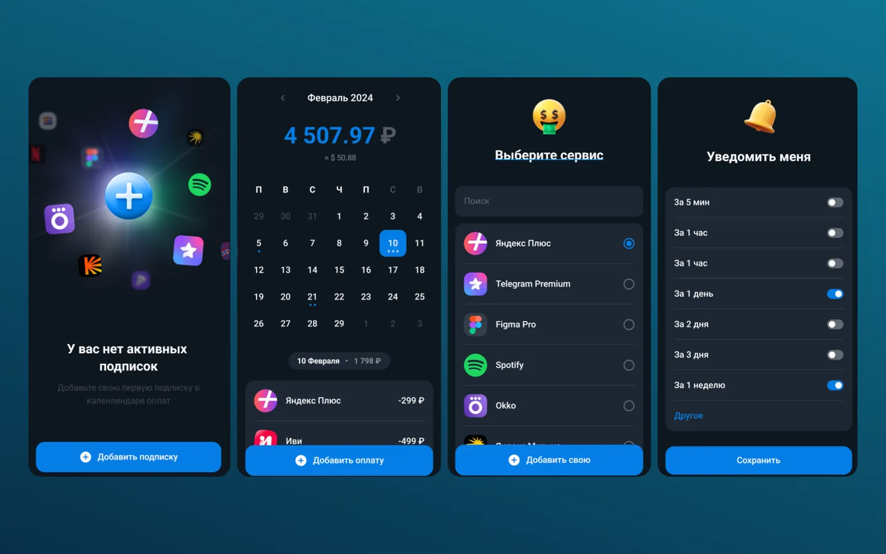

Подписки списывают деньги в разные дни, и вспоминаешь о них обычно после смс от банка. Notify собирает их в один календарь — открывается из Телеграма, ставить ничего не нужно.

<figure class="shot">
  <button type="button" popovertarget="shot-01" aria-label="Открыть снимок в полном размере">
    
  </button>
  

    <button class="shot-back" type="button" popovertarget="shot-01" popovertargetaction="hide" aria-label="Закрыть снимок"></button>
    <button class="shot-zoom" type="button" popovertarget="shot-01" popovertargetaction="hide" aria-label="Закрыть снимок">
      
    </button>
  

</figure>

На каждой дате видно, что и сколько спишется, а по всему периоду считается, сколько уходит и сколько уйдёт в ближайший месяц. Вопрос «куда уходят деньги» перестаёт быть загадкой.

Управление в одном центре: добавить подписку, поправить дату или сумму, отключить ненужную. Приложение само показывает, что будет дальше, и предупреждает о списании — не нужно помнить про каждую.
