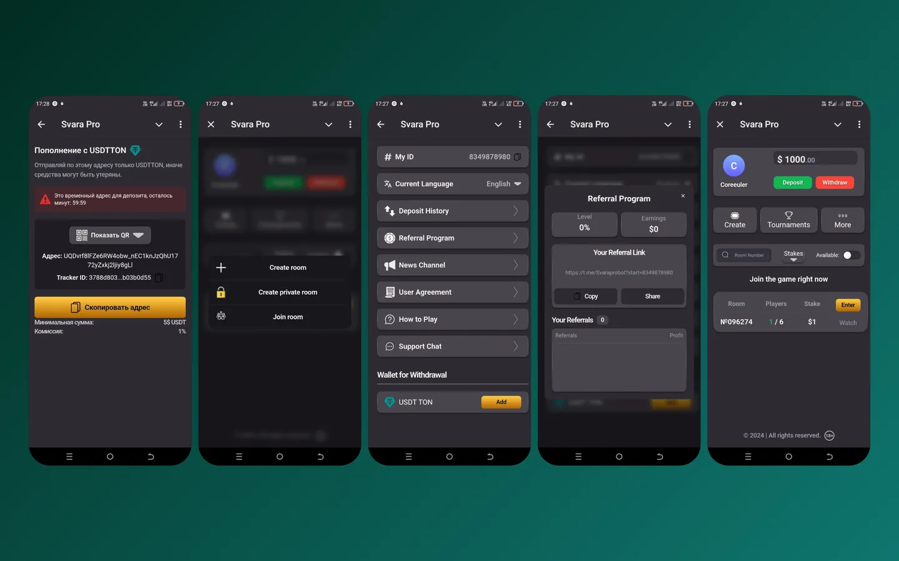
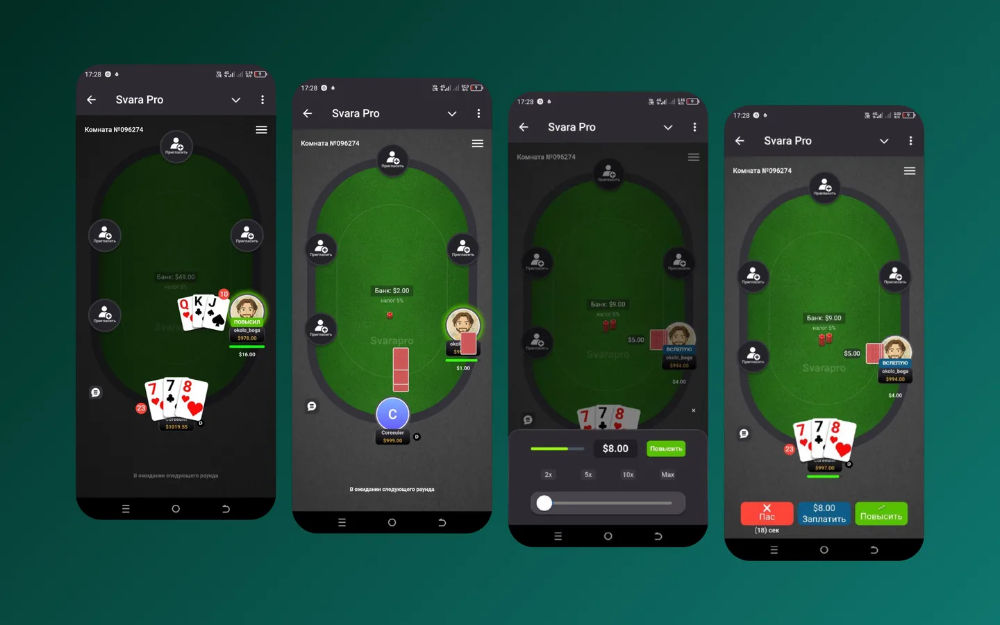

Карточная игра для шести человек внутри Телеграма: стол, ходы, ставки. Ничего не нужно скачивать — игра открывается из мессенджера.

<figure class="shot">
  <button type="button" popovertarget="shot-01" aria-label="Открыть снимок в полном размере">
    
  </button>
  

    <button type="button" popovertarget="shot-01" popovertargetaction="hide" aria-label="Закрыть снимок">
      
    </button>
  

</figure>

Всё сложное здесь — синхронность. Шесть игроков ждут хода друг друга, а сеть у всех разная: сервер держит состояние партии и не даёт двоим сходить одним ходом. Обрыв связи не ломает стол — игрок возвращается в партию, а не начинает заново.

<figure class="shot">
  <button type="button" popovertarget="shot-02" aria-label="Открыть снимок в полном размере">
    
  </button>
  

    <button type="button" popovertarget="shot-02" popovertargetaction="hide" aria-label="Закрыть снимок">
      
    </button>
  

</figure>

Вокруг игры — реферальная программа, чтобы игроки приводили новых, и ставки в TON и USDT с проверкой баланса до начала партии. Расширение механик осталось за рамками согласованного объёма — это отдельный этап, а не забытая работа.
